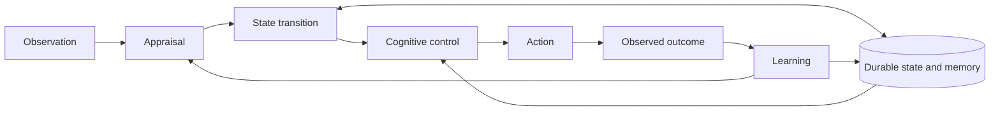
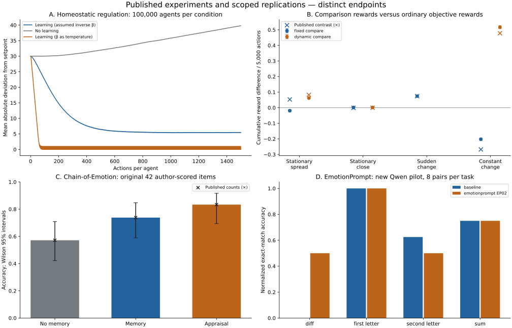

# Regesh

**Persistent affect. Inspectable causes. Reproducible experiments.**

[](pyproject.toml)
[](LICENSE)
[](docs/architecture.md)
[](docs/rust_memory.md)

Regesh is a local research platform for persistent, developing affect in AI
agents. It connects versioned observations and appraisals to durable state,
memory and cognitive control, with replay and causal interventions.

| Capability | What it provides |
|---|---|
| 🧠 Persistent state | Mixed affect, mood, relationships and expectations that develop across interactions and restarts. |
| 🔎 Inspectable behavior | Evidence-preserving memory, cognitive controls, snapshots, interventions and provider-free replay. |
| 🧪 Reproducible research | Offline fixtures, real-model adapters, executable benchmarks and published-paper comparisons. |

[Quick start](#run-locally) · [How it works](#how-it-works) · [Measured results](#measured-results) · [SDK](#sdk) · [Research](#research-and-results)

> [!NOTE]
> **Experimental research software.** Current studies do not demonstrate an
> affect-specific improvement in useful idea generation. Biological fidelity
> and subjective experience remain unestablished.

## Run locally

Python 3.11+ and NumPy; CPU only. No API key is needed for offline work.

```bash
python -m pip install -e .
python -m regesh demo --db demo.sqlite
python -m regesh inspect --db demo.sqlite
# Open http://127.0.0.1:8765
python -m unittest discover -s tests -v
python -m regesh core-eval --output results/core-new
python -m regesh benchmark --output results/benchmark-new
```

The full default benchmark trains on 6,144 observed transitions and runs 88 development plus 660 test trials, 32 objective probes per trial, across 11 conditions. Every condition shares information, action operators, model-prediction counts and probe budget. Actual timings and all raw evidence are retained. Use a new output directory to preserve a run. Distributed raw JSONL archives may be gzip-compressed; `gzip -dk FILE.jsonl.gz` restores them. Fresh runs produce plain JSONL.

## How it works



Appraisal considers goals, expectations, relationships and controllability.
State influences retrieval, exploration, verification and planning. Observations,
interpretations and outcomes remain distinct in the saved causal history.

## Measured results

| Study | Observed result | Evidence |
|---|---|---|
| Compact journaling | About **97% less retained storage** at 250 events. | [Memory profiles](docs/rust_memory.md) |
| Snapshot lookup | **89.5% lower peak RAM** in the isolated 250-event comparison. | [Extended report](docs/extended_report.md) |
| Real-model software pilot | Hybrid **29.17%** vs ordinary **28.24%** hidden-check pass rate; difference +0.93 points, 95% interval [−4.17, 6.94]. | [Protocol and results](docs/extended_report.md#same-real-model-frozen-controllers-executable-held-out-tasks) |
| Published-paper experiments | **Three core reproductions and a fourth scoped replication**, with mixed results and explicit failed matches. | [Paper comparisons](docs/paper_reproductions.md) |

Neither software controller produced a fully correct final solution. Rust works
as an optional backend but showed no dependable CPU/RAM advantage. These measured
results do not establish affect superiority.

The paper studies include 482 million homeostatic transitions, 190 million bandit
choices, original Chain-of-Emotion data reanalysis and 64 new EmotionPrompt calls.
Fixed comparison matches ordinary optimistic learning in the tested bandits;
the prompting study exposes a format confound.

<details>
<summary><strong>View the quantitative paper comparisons</strong></summary>



Each panel measures a different endpoint. Chain-of-Emotion reuses original
observations; the EmotionPrompt pilot changes the model and task scope.
See the [full report](docs/paper_reproductions.md) for uncertainty, causal controls
and reproduction limits.

</details>

## SDK

```python
from regesh import Agent, Event

agent = Agent('agent.sqlite', agent_id='researcher')
event = Event('test-1', 'unit-tests', 'checker', 'proposal', 'software',
              '2026-10-25T00:00:00Z',
              data={'goal_delta': {'quality': -.5}, 'control': .7})
agent.observe(event)
controls = agent.actuation_context()  # exploration, verification, retrieval, horizon
agent.act('verify')                  # allocation consumes operational resources
agent.record_artifact('tool_result', {'passed': False})
agent.record_outcome(event.id, -.5, provenance='independent executable checker')
snapshot = agent.snapshot()
child = agent.fork('comparison')
replayed = agent.replay('recomputed') # recorded appraisals; checks every poststate
assert agent.get_state() == replayed.get_state()
child.close(); replayed.close(); agent.close()
```

Observations and outcomes must come from appropriately trusted sources. Model-generated interpretations do not establish facts or grant tool permissions. Event identities and outcome identities are idempotent. Recall can reactivate state without counting as fresh evidence.

`observe`, `appraise`, `advance_time`, `get_state`, `actuation_context`, `act`, `record_outcome`, `retrieve`, `reappraise`, `snapshot`, `restore`, `fork`, `reset`, `intervene`, and `replay` form the SDK. See [architecture and time semantics](docs/architecture.md), [CLI/model/inspector interfaces](docs/interfaces.md), and [existing-agent example](examples/agent_loop.py).

## Learned mechanism and model adapter

```python
from regesh.learning import RidgePredictor
agent = Agent('agent.sqlite', agent_id='learned')
agent.set_regulator(RidgePredictor.load('results/benchmark/counterfactual_weights.json'))
agent.set_task_context({'quality': .4, 'uncertainty': .6})
print(agent.actuation_context())      # predicted alternative consequences and scores
agent.act('auto')
agent.close()
```

The saved model is trained in the toy simulator. Transfer to arbitrary host agents is unvalidated. Shared weights and an individual's adaptive history are saved separately.

`regesh.providers.LocalChatModel` supports an explicitly configured OpenAI-compatible server, including vLLM. It preserves exact requests/responses, seeds, timing and returned usage. Neither a GPU, hosted model nor credential is assumed. `FixtureModel` works offline. A same-model numeric-design comparison is runnable when a server is available:

```bash
python -m regesh.live_benchmark \
  --base-url http://localhost:8000/v1 --model YOUR_SERVED_MODEL \
  --weights results/benchmark --output results/live-new \
  --seeds 800 801 802 --budget 8 --max-tokens 192
```

Default ceiling: 504 model calls and 96,768 completion tokens; input tokens are additional. See [live protocol and recorded-response replay](docs/live_protocol.md). The initial study had no configured endpoint. The extension provisioned an open-weight CPU model and completed the software and psychology pilots; their measured results are separate from this original numeric-design runner and its fixtures.

## Compact memory, datasets and expanded experiments

Compact Python storage is the default. The optional Rust kernel uses the same
lossless representation; it is an evaluated alternative, not a blanket speed claim:

```bash
cargo test --locked --manifest-path native/Cargo.toml
cargo build --release --locked --manifest-path native/Cargo.toml
REGESH_MEMORY_BACKEND=rust python -m regesh demo --db rust-demo.sqlite
```

See [memory profiles and remaining scaling limits](docs/rust_memory.md).
`agent.iter_trace()` and default replay stream history; `trace()` explicitly
materializes it. Original numerical behavior is unchanged.

The [dataset catalog](docs/datasets.md) covers 57 resources with license/access
checks. Four have pinned verified downloads. The [psychology suite](docs/psychometrics.md)
uses external answer keys, response-order/persona checks and calibration/coverage;
it does not infer clinical traits or feelings. Full EmoBench conversion and a
small supervised human-label reference are runnable:

```bash
python scripts/fetch_datasets.py --cache .cache/regesh-data
python scripts/prepare_emobench.py --cache .cache/regesh-data --output .cache/emobench-all
python -m regesh.dataset_baseline --cache .cache/regesh-data --output results/recognition-new
```

To reproduce local real-model inference, use Python 3.12+ for the prebuilt helper
(or its source-build option), Linux x64 and about 1.12 GB model download:

```bash
python scripts/prepare_local_model.py --cache .cache/regesh-model --prebuilt-server
.cache/regesh-model/llama-b11878/llama-server \
  --model .cache/regesh-model/qwen2.5-coder-1.5b-instruct-q4_k_m.gguf \
  --host 127.0.0.1 --port 8080 --alias regesh-qwen-coder \
  --ctx-size 8192 --parallel 1 --threads 4 --threads-batch 4 --n-gpu-layers 0
# In a second terminal:
python -m regesh.software_eval --base-url http://127.0.0.1:8080/v1 \
  --model regesh-qwen-coder --config configs/software_cpu_pilot.json \
  --weights results/benchmark --output results/software-new --timeout 300
python -m regesh.psych_eval --items datasets/emobench_pilot.jsonl \
  --base-url http://127.0.0.1:8080/v1 --model regesh-qwen-coder \
  --permutation --persona --max-tokens 128 --timeout 300 --output results/psych-new
```

The completed CPU pilot used 48 software and 36 QA calls; the larger software
configuration remains available. Exact limits, raw costs, source/model hashes,
runtime corrections and seed nondeterminism are documented. [Recorded-response
replay](docs/software_replay.md) verifies every actor phase without a model and
separately rechecks the executable outcomes. [Expanded measurements](docs/measurement_framework.md)
and [frozen secondary analysis](docs/extended_analysis.md) keep correctness,
robustness, repair, cost, calibration, coverage and diversity proxies separate.

## Research and results

- [Published-paper reproductions, quantitative comparisons and run commands](docs/paper_reproductions.md)
- [Extended measured report with figures](docs/extended_report.md)
- [Initial research report and claim ledger](docs/research_report.md)
- [Prior-art matrix: 28 primary-source comparisons](docs/research_matrix.md)
- [Ten competing hypotheses and independent critic](docs/hypotheses.md)
- [Benchmark protocol](docs/benchmark_protocol.md) and [executed results](results/benchmark/report.md)
- [Core histories, interventions and feedback measurements](results/core/core_experiments.json)
- [Independent adversarial review](docs/adversarial_review.md), [experiment critique](docs/experiment_critique.md), and [pilot provenance](docs/exploratory_pilot.md)
- [Static inspector example](results/inspector.html) and [durable work log](docs/WORK_LOG.md)

Persistence, appraisal, multiple timescales, emotional memory, homeostatic control and creative search scheduling have substantial prior art. The possible research contribution is the precise learned operational-consequence coupling and its controlled evaluation; architectural originality is not established by naming the state emotional.
