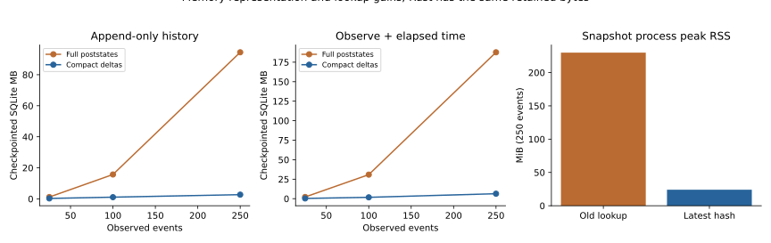
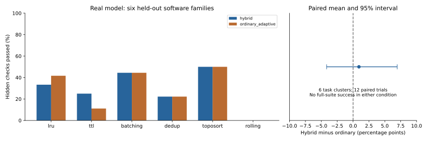
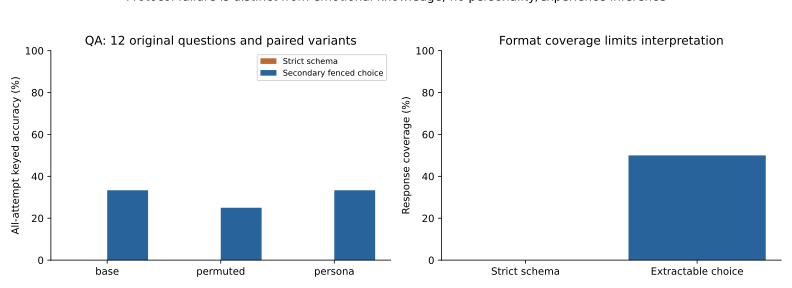
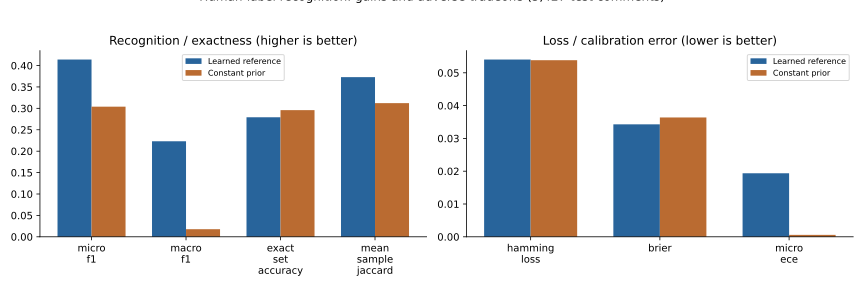

# Compact memory, real-model experiments and broader quality measurement

Subsequent work: [three published-paper reproductions plus a scoped real-model
replication](paper_reproductions.md). Those studies preserve the measurements
below and add quantitative prior-art comparisons, partial failures and causal
controls.

**Executed 2026-10-25.** Memory retention and snapshots are substantially lighter.
An integrated Rust backend works, but it did not show a dependable speed/RAM
advantage, so compact Python is the default. The real-model software pilot did
**not** demonstrate better useful solutions from the frozen hybrid. The expanded
measurement battery exposes output-format failures, revision regressions,
calibration gaps and dataset-label tradeoffs that one score would conceal.

## Lightweight memory and the Rust decision

| Measured workload | Full-history representation | Compact / new lookup |
|---|---:|---:|
| Retained SQLite, 250 appended events | 94.46 MB | 2.73 MB |
| Retained SQLite, 250 events with clock advancement | 187.70 MB | 6.41 MB |
| Snapshot process peak RSS, 250 events | 235,460 KiB | 24,608 KiB |

The journal savings are **97.1%** and **96.6%**; the isolated snapshot comparison
reduces peak RSS **89.5%**. These are measured points, not extrapolated capacity
claims. Checkpointed disk figures exclude the truncated WAL. The snapshot test
has one fresh process per condition; timings are descriptive.

The original bottleneck was repeatedly storing/materializing the complete growing
history. Lossless nested deltas now retain logical full-poststate semantics,
legacy/mixed-journal compatibility, exact hash chains, atomic updates and all
observations. Snapshots use latest-hash lookup, and default replay streams entries.
The entire original core experiment reproduces **exactly unchanged numerical
measurements and trajectories** with compact storage.

`native/` contains a compiled/tested Rust JSON-difference kernel and a C ABI used
by the actual writer when selected. It preserves numeric representation and has
observable Python fallbacks for supported inputs beyond the native parser's depth
or Unicode handling. The release library is about 610 KiB. Python and Rust produce
the same retained journal representation. Rust adds a second parsed tree, and the
measured runtime/RSS tradeoffs were mixed or worse. **Rust remains opt-in**, not
an assumed optimization. Raw two-repetition profiles, source snapshots, isolated
snapshot results and limitations are in [memory documentation](rust_memory.md).

Clocked histories can still have quadratic changed-leaf volume, and each mutation
still materializes the complete current state. Explicit `trace()` and the inspector
can also retain full history. This is a large practical improvement, not an
unbounded-memory solution; cold immutable episodes and lazy decay are further
architectural work.

## Same real model, frozen controllers, executable held-out tasks

The local model was official **Qwen2.5-Coder-1.5B-Instruct, Q4_K_M**, Apache-2.0,
served with pinned llama.cpp b11878 on CPU. Exact model/archive hashes, runtime
arguments and resource metadata are in [runtime provenance](../results/runtime/model.json).
No paid API or new credential was used. The environment exposed five virtual cores
with a four-CPU-equivalent quota and about 17 GiB RAM.

The protocol/source was committed before held-out generation. An unrelated runtime
probe motivated a documented **two-seed CPU pilot before any task outputs were
inspected**: six new executable software families × two generation seeds × two
conditions = **24 trials / 12 pairs / 48 model calls**. The larger four-seed
configuration is retained but was not executed. Both conditions share the same
model, temperature 0.6, seeds, information access, 512 completion-token ceiling per
call, two candidate calls, one public diagnostic and two evaluator-only checks.
The two hidden checks retrospectively grade initial and final code only after
both generations; hidden results never select candidates or enter prompts.

The six tasks cover LRU state, TTL expiry, constrained batching, window deduplication,
deterministic topological scheduling and rolling statistics. Each hidden suite
contains 18 boundary/generated/metamorphic/scaling cases with an independent oracle.
The pure-function execution harness restricts syntax and uses subprocess resource
limits; it is not a general-purpose sandbox. Shared hybrid/direct weights from
the procedural study remain frozen. Their transfer to code-generation strategies
is unvalidated, and task analogues may occur in model pretraining.

| Endpoint | Hybrid | Ordinary adaptive |
|---|---:|---:|
| Final hidden checks passed | 63/216 = 29.17% | 61/216 = 28.24% |
| Candidates passing every hidden check | 0/12 | 0/12 |
| Boundary pass rate | 51.39% | 50.00% |
| Generated-case pass rate | 5.56% | 5.56% |
| Metamorphic pass rate | 37.50% | 35.42% |
| Same-hidden-suite change after feedback | −1.85 points | −6.02 points |
| Actual reported prompt + completion tokens | 26,837 | 27,308 |
| Model / visible feedback / evaluator calls | 24 / 12 / 24 | 24 / 12 / 24 |

Hybrid-minus-ordinary hidden pass fraction is **+0.93 percentage points**, with
95% paired task-cluster bootstrap interval **[−4.17, +6.94] points**. This does not
demonstrate a gain. Both controllers regress after feedback on the same hidden
suite. No candidate fully succeeds and none supplies the optional confidence
comment, so correct-only efficiency and code-confidence calibration are
**undefined**, not favorable zeroes. Source/operation diversity remains a weak
implementation proxy, not evidence of original ideas.

The grader's failures include fixed-length unpacking of variable-length operations,
missing cumulative-capacity checks, incorrect returned structures and omitted
cycle/ordering rules. All 48 responses finished normally with no provider error;
truncation does not explain these failures. The small coding model, strict pure-code
interface and task difficulty impose a floor that limits causal sensitivity.

Actions differ in **8/24** paired decisions, all on the second attempt (8/12).
Another limitation is important: all twelve paired initial prompts/seeds match,
but only **7/12 initial response texts** match exactly. The cause was not measured;
server/runtime numerical behavior may contribute. No pair was removed. A shared
initial candidate/history fork would control that nuisance more cleanly.

[Record-only replay](software_replay.md) verified all 24 trajectories and 48 actor
phases with **zero model/network calls**, consuming recorded public observations.
A separate 48-call evaluator-only recheck reproduced every functional/pass/error/
line result. Exact recorded replay and fresh model re-execution are different.
All prompts, outputs, sources, feedback, costs and failures are retained.

## Psychology-style questions: useful, but a distinct construct

The [EmoBench adapter](psychometrics.md) converts the pinned author-MIT corpus into
**400 English QA items**, or 600 questions including cause questions across the
same 400 scenarios. It regenerates the locked pilot byte-for-byte. The actual
model pilot used **12 independent questions** (understanding/application), each
with base, option-permuted and optimistic-persona versions: **36 model calls**,
not 36 independent scenarios. Author keys are external to the generating model.

The strict answer-plus-normalized-probability schema failed on **all 36 attempts**.
All responses were fenced JSON; some also used unoffered answer text or invalid
probability totals. Thus strict output coverage and accuracy are zero, and proper
probability/calibration measures are unavailable. This is an **instruction/protocol
failure**, not proof of absent emotional knowledge.

A conservative secondary diagnostic was defined before correctness inspection:
allow one exact JSON fence and extract only a legal offered letter from a completed
object, without prose guessing, truncation repair or matching text to gold.
It extracts **18/36** answers and scores **11/36 = 30.56%** over all attempts
(11/18 conditional; coverage 50%; question-cluster interval [11.11%, 50.00%]).
On the original base questions: **4/12 = 33.33%**, six extractable choices,
interval [8.33%, 58.33%]. The broad intervals and incomplete coverage limit any
ability conclusion. This QA pilot does not compare affect controllers.

An earlier shared-slot run used a 60-second HTTP deadline and was aborted; five
completed records and at most one in-flight request remain separately archived.
The complete run uses 300 seconds and retains every attempted item, with no
provider errors. After completion, macro-F1 was corrected to the conventional
union of gold/predicted labels; the original summary/scorer are preserved and all
primary accuracy, probability and coverage results are unchanged.

[Psychometric primary research](psychometric_basis.md) supports testing knowledge,
reliability, validity and response susceptibility separately. Public-domain IPIP
personality items have no universally correct answer. Human trait norms, clinical
interpretations, biological fidelity and subjective experience were not measured.

## Datasets made practical for training and evaluation

The [catalog](datasets.md) records **57 resources** across affect, memory, social/
psychological reasoning, creativity, software and human quality judgments. Twenty-
seven have published permissive declarations and one is public domain; others
have noncommercial, no-derivatives, gated, source-available or unresolved terms.
Public access and open-source code do not automatically license underlying data.
Primary metadata/terms were checked in a bounded review, not an exhaustive legal
or literature audit.

Nine pinned, size/SHA-verified artifacts from **four datasets** were actually
fetched: EmoBench, GoEmotions, HumanEval and MBPP. Only reviewed sources enter the
automatic downloader. Raw caches remain outside Git; redistribution notices and
provenance are retained. New experiments use supplied adapters rather than
executing arbitrary dataset code or mixing evaluation labels into prompts.

One download was also used for a small supervised recognition reference:
**39,013 fit / 4,397 development / 5,427 official-test** GoEmotions comments,
28 human annotation labels. A 4,096-feature hashed Bernoulli model learns only
from fit data; development chooses temperature/threshold; official test data
never tunes the model. Main affect controllers are untouched.

| Human-label recognition metric | Learned reference | Constant prior |
|---|---:|---:|
| Micro-F1 | 0.4141 | 0.3040 |
| Macro-F1 | 0.2231 | 0.0177 |
| Exact label-set accuracy | 0.2792 | 0.2959 |
| Hamming loss ↓ | 0.0541 | 0.0538 |
| Brier ↓ | 0.0343 | 0.0364 |
| Micro calibration error ↓ | 0.0194 | 0.0006 |

The micro-F1 difference is +0.1101, comment-bootstrap interval [0.0969, 0.1232],
but exact sets, Hamming loss and calibration error worsen. All five rarest labels
have F1=0. Correlated comments/threads could make comment-level intervals too
narrow. This demonstrates useful training infrastructure and the need for multiple
endpoints, not improved agent affect. Learned arrays use **458,976 bytes**; the
compressed model is **251,343 bytes**. The archived run took about **5.7 seconds
on one CPU**. Independent set/count calculations reproduce its primary scores.

## Verification, measured scope, and next experiment

All **141 Python tests pass under both compact-Python and Rust storage modes**, plus **two Rust unit tests**. The final wheel builds successfully. Original reference-core results remain bit-for-bit unchanged; actual recorded software trajectories and executable rechecks match. These tests validate implementation/protocol mechanics; model performance is the separately reported real evidence above. Figures are reproducible with `python scripts/plot_extended.py` (optional `analysis` dependencies).

The [measurement framework](measurement_framework.md) and [independent multi-axis
analysis](extended_analysis.md) cover storage/RSS/latency, durable/replay correctness,
hidden usefulness, boundary/metamorphic/scaling robustness, same-suite repair and
regression, source validity, constraints, correct-only efficiency, confidence/
coverage, proper scoring, selective risk, position/persona sensitivity, source
trust, development, recall integrity and feedback recovery. Not every axis has a
valid numerical value in every study; missing values remain explicit. No aggregate
emotion or creativity leaderboard hides these differences.

Evidence is separated into real-model observations, human-label recognition,
controller fixtures, performance profiles and unexecuted broader studies. No new
architectural-priority or subjective-experience claim is made. Novel research-idea
originality, real longitudinal relationships, physiological fidelity and strong
model generalization remain untested.

The next most informative comparison would fork **one common checked initial
candidate/history** into both controllers, use a coding model/task regime with
substantial baseline full-task success, and validate decoding/replay behavior
before a larger prospectively fixed task-family/seed study. That would address the
floor, distribution shift and initial-history noise exposed here. The present
pilot already answers the narrower question honestly: no demonstrated advantage.
