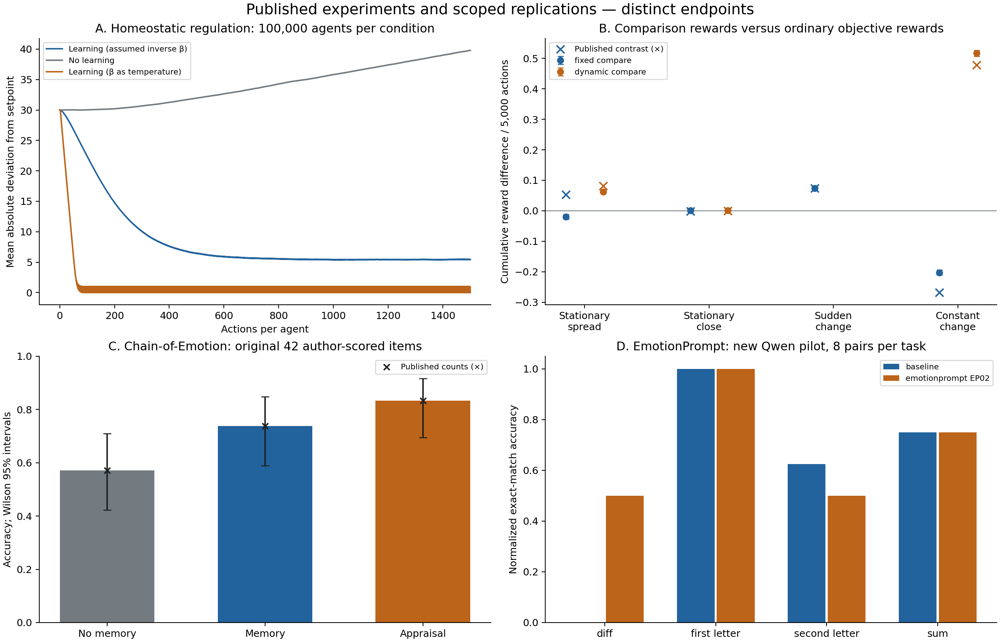

# Published-paper experiment reproductions

Search and execution date: **2026-10-25**. We completed experiments for **three
core papers**, plus a fourth, smaller real-model method replication. Results are
mixed: several published observations reproduce, some numerical results do not,
and two additional controls expose ordinary-learning and answer-format
explanations. These studies do not establish that Regesh improves useful idea
generation. Historical platform results and trained controllers are unchanged.

## Papers and reproduction fidelity

| Paper | Executed experiment | What reproduced and what did not |
|---|---|---|
| Keramati & Gutkin, [*Homeostatic reinforcement learning for integrating reward collection and physiological stability*](https://doi.org/10.7554/eLife.04811), eLife 2014 | Independent implementation of Figure 6: three 100,000-agent cohorts × 1,500 actions, plus 32 million-action trajectories | Regulation emerges; mean absolute deviation 5.419 versus 39.798 without learning. Published population maximum **61 did not reproduce: 86**. Original code/RNG and softmax convention remain unresolved. |
| Dubey, Griffiths & Dayan, [*The pursuit of happiness: A reinforcement learning perspective on habituation and comparisons*](https://doi.org/10.1371/journal.pcbi.1010316), PLOS Computational Biology 2022 | Independent implementation of Experiments 2a/2b: four bandit environments, 2,000 rounds × 5,000 actions per condition | Sudden-change advantage **+370.82**, versus published **+370.11**. Stationary fixed comparison reverses: **−95.60**, versus published **+264.50**. Fixed comparison exactly equals ordinary optimistic initialization. |
| Croissant et al., [*An appraisal-based chain-of-emotion architecture for affective language model game agents*](https://doi.org/10.1371/journal.pone.0301033), PLOS ONE 2024 | Statistical reproduction using original released scores, LIWC outputs and 30 participants' ratings | STEU counts reproduce exactly: **24/42, 31/42, 35/42**. Most LIWC statistics closely reproduce under numeric condition coding. Published questionnaire statistics do not exactly reproduce from all released records. |
| Li et al., [*The Good, The Bad, and Why: Unveiling Emotions in Generative AI*](https://proceedings.mlr.press/v235/li24bs.html), ICML 2024 | Scoped EmotionPrompt EP02 replication: original execution examples, four tasks, 32 pairs / 64 real Qwen calls | Exact-match accuracy **59.38% → 68.75%**, difference **+9.38 points**, 95% paired interval **[−3.13, 21.88]**, p=.4531. Arithmetic-content diagnostic finds **12/16 correct in both conditions**. Different model/scope prevents reproducing the original aggregate. |

All four are peer-reviewed papers. Three experiments inside Chain-of-Emotion
count as one paper. “Independent implementation” means the reported computation
was reimplemented with disclosed assumptions; “statistical reproduction” reuses
the original observations. Neither means an original-code, original-seed rerun.
The [search record](reproductions/paper_search.md) explains other candidates and
why a previous EmoBench pilot does not reproduce that paper's complete protocol.



The panels have different dependent variables and are not combined into one
affect-quality score. Panel A's opposite-softmax curve oscillates with even/odd
action times. Panel B preserves published exploration/learning settings, which
also differ between some conditions. Panel C reuses author observations. Panel D
shows the original exact-match endpoint, including format sensitivity.

## 1. Homeostatic learning: regulatory effect, unresolved tail discrepancy

The Figure 6 implementation uses the paper's one-dimensional drive
`D(H)=abs(H)^(4/3)`, drive-reduction rewards and tabular Q-learning with the
supplementary parameters. Each agent has an independent table. A finite storage
guard raises on an excursion; no state is clipped or reflected to manufacture
stability. The prespecified primary interprets beta as inverse temperature;
the opposite convention is retained as a sensitivity, without outcome tuning.

| Endpoint | Published | Executed primary |
|---|---|---|
| 100,000 agents, 1,500 actions: largest absolute deviation | 61 | **86**; 86 agents exceed 61 |
| Million-action trajectory: largest absolute deviation | One reported realization stays within 40 | Across 32 independent replicas: range **32–50**; **21/32** stay within 40 |
| Final population mean | Converges toward setpoint; no tabulated endpoint | **0.04668** |
| Final mean absolute deviation | No tabulated endpoint | **5.41912**, versus no-learning **39.79792** |

The added learning-versus-random-walk contrast is −34.3788 mean absolute
deviation, normal 95% interval [−34.5655, −34.1921] across 32 independent seed
batches. This establishes a causal effect of learning in the implemented
simulation. It is not an affect-versus-ordinary-adaptation comparison.

The population maximum disagrees with the paper. The missing implementation
details are possible sources of discrepancy, not a verified explanation or a
reason to call it successful numerical reproduction. Finite trajectories do
not establish a perpetual safety boundary. Separately labeled post hoc
diagnostics show that the opposite-softmax endpoint near zero is phase-sensitive:
its final-100-action mean absolute deviation is **0.500034**.

See [methods, source verification and full results](reproductions/homeostatic.md)
and [raw arrays / manifest](../results/papers/homeostatic/manifest.json).

## 2. Habituation and comparisons: partial reproduction and an ordinary explanation

The bandit run executes 15 original condition cells plus four ordinary controls:
**38,000 round records and 190 million choices**. It retains published selected
hyperparameters rather than repeating or retuning the original grid search.
Original bandit code/seeds were not found in the released gridworld repository;
initial Q values, tie breaking and random draw order are disclosed choices.
One unspecified sudden-change dynamic schedule is omitted.

Representative direct comparisons use cumulative objective reward after
5,000 actions. “±” is between-round **SD**, not a confidence interval:

| Environment / condition | Published mean ± SD | Reimplemented mean ± SD |
|---|---:|---:|
| Stationary spread / objective | 4384.07 ± 219.66 | 4396.97 ± 238.21 |
| Stationary spread / fixed comparison | 4648.57 ± 182.93 | **4301.38 ± 1019.73** |
| Stationary spread / dynamic comparison | 4796.07 ± 326.45 | 4705.47 ± 499.19 |
| Sudden change / objective | 4191.19 ± 180.47 | 4195.78 ± 190.15 |
| Sudden change / fixed comparison | 4561.30 ± 235.11 | 4566.60 ± 234.13 |
| Constant change / objective | 32220.31 ± 9930.40 | 32536.11 ± 10157.20 |
| Constant change / dynamic comparison | 34609.12 ± 10717.57 | 35119.04 ± 10931.65 |

The sudden-change fixed advantage is **+370.82 [358.07, 384.14]**, close to
the published difference +370.11. The constant-change dynamic advantage is
**+2582.93 [2534.98, 2630.21]**, versus published +2388.81. In stationary spread,
fixed comparison instead loses **95.60 [60.00, 134.74]** reward; the paper reports
a gain of 264.50. That directional failure and much larger dispersion remain
unresolved. All local intervals bootstrap paired seed-block means; raw results
and the complete table include UCB, close-arm tasks and regret/action measures.
These are nominal intervals, without a global multiplicity correction.

For fixed aspiration rho, translating `Q_ordinary = Q_comparison + rho` turns
the reward-offset rule into ordinary objective learning with optimistic initial
values. The extra control matches epsilon, learning rate and random draws:
**zero action disagreements across 40 million paired decisions**, with identical
objective rewards. Thus this fixed-comparison mechanism does not require a
distinct affective explanation. Dynamic aspiration is not covered by the fixed
translation; its schedule here is designer-supplied. The original condition
comparison also changes exploration and sometimes learning rate, so its gains
cannot isolate the reward definition alone.

The paper already compares optimistic initialization in its
[Supplement S1](https://doi.org/10.1371/journal.pcbi.1010316.s001), using gridworld
experiments and an initial-value search bounded at one. Those experiments were
not reproduced here. The bandit equivalence is scoped to a constant reward
offset and matched initialization; it neither establishes new theory nor
refutes all of the paper's stateful or dynamic-comparison claims.

See [full methods and measured table](reproductions/happiness.md) and
[raw rounds / manifest](../results/papers/happiness/manifest.json).

## 3. Chain-of-Emotion: exact scores, analysis-dependent inference

All three [original OSF CSVs](https://doi.org/10.17605/OSF.IO/QPT6Z) were downloaded
and checksum-verified. They remain outside Git because the OSF node declares no
explicit data license. No new participants or GPT-3.5 responses were collected;
LIWC's proprietary dictionary was not rerun.

The original 42 author-scored STEU items reproduce **24, 31 and 35 correct** for
No Memory, Memory and Appraisal Prompts. Appraisal versus No Memory increases
accuracy by **26.19 points**, paired-item bootstrap interval [11.90, 40.48],
Holm-adjusted exact McNemar p=.01025 across three contrasts. Its incremental
gain over Memory is **9.52 points**, p=.21875. Author-coded correctness was not
independently re-annotated; item resampling does not measure inference-seed
variation or clinical validity.

For released LIWC authenticity scores, numeric condition coding gives
**F(1,71)=5.09332, p=.02710**, close to published 5.10/.03. Treating the three
conditions as categorical gives **F(2,70)=3.30174, p=.04263**. Neither survives
Holm across six outcomes. The 73 sentence rows originate from only three
conversations, so sentence-level significance cannot establish a population
architecture advantage.

All **30 participants / 90 rows** are retained for questionnaire analysis.
Published means and F values do not exactly reproduce; the printed residual
df=84 differs from both full-data independent df=87 and paired df=58. With
participant pairing, Greenhouse–Geisser correction and Holm across 12 items,
only naturalness survives (adjusted p=.01330). An additional, explicitly post hoc
Friedman rank analysis retains naturalness, responsiveness and emotion
sensitivity (Holm p=.02271, .02596 and .01745). These are correlated analyses
of the same small sample, not independent confirmations. The latter two effects
depend on the statistical assumptions; omnibus tests also do not establish a
specific appraisal-versus-memory contrast.

See [paper reproduction and sensitivity details](reproductions/chain_emotion.md),
[original-analysis comparison](../results/papers/chain_emotion/report.md),
[ordinal sensitivity](../results/papers/ordinal_sensitivity.json) and
[independent reviewer calculations](../results/papers/reviewer_checks.json).

## 4. EmotionPrompt: a small real-model replication exposes format sensitivity

The ICML paper reports an aggregate zero-shot accuracy increase
**62.83% → 65.41%** across 24 tasks, three models and multiple stimuli. Our
EP02-only experiment uses four original tasks, eight hash-selected examples
per task, and the pinned Qwen2.5-Coder-1.5B-Instruct Q4_K_M CPU model. This
changes the estimand; its 9.38-point change cannot be compared as a reproduction
of the paper's 2.58-point aggregate effect.

The frozen original benchmark scorer yields **19/32 versus 22/32** correct:
five gains, two losses; paired within-task 95% interval **[−3.13, 21.88]** points;
exact McNemar **p=.453125**. Four-task cluster interval is [−9.38, 37.50] points.
All 64 responses are retained, with zero provider errors and one truncated
baseline answer. Total actual tokens differ: **1,624 versus 1,819**. Equal
completion caps do not equalize prompt length; no neutral length control ran.

After inspecting the outcomes, a restricted arithmetic-content checker found
**12/16 correct in both conditions**. Six correct baseline equations and two
correct treatment equations were rejected by the original exact-match metric.
Across all tasks, this exploratory checker yields 25/32 versus 24/32. It does
not replace the frozen primary result or establish an opposite effect. It
shows why the primary increase cannot establish improved arithmetic ability,
creative problem solving or persistent affect.

See [protocol and full results](reproductions/emotionprompt.md),
[recorded model responses](../results/papers/emotionprompt/live/calls.jsonl), and
[unmodified upstream-scorer audit](../results/papers/emotionprompt/audit.json).

## Reproduce and inspect

From the repository root, with Python 3.11+ (3.12 used here):

```bash
python -m pip install -e '.[papers,analysis]'
python -m regesh.reproductions.homeostatic --output results-new/homeostatic
python -m regesh.reproductions.happiness --output results-new/happiness
python -m regesh.reproductions.chain_emotion \
  --cache .cache/papers/chain_emotion --fetch --output results-new/chain-emotion
# Start the pinned model using the existing README/model preparation instructions:
python -m regesh.reproductions.emotionprompt \
  --base-url http://127.0.0.1:8080/v1 --model regesh-qwen-coder \
  --output results-new/emotionprompt
```

Use empty output directories. Numerical studies need no LLM or GPU; both full
simulation jobs took roughly eight minutes wall time here while overlapping
CPU inference. The new live ceiling was 64 calls / 2,048 completion tokens;
input tokens are additional. No paid APIs were used. The local service was
stopped after the study, with its pinned model cache retained.

To verify delivered evidence without simulation or live inference:

```bash
python scripts/audit_paper_reproductions.py \
  --chain-cache .cache/papers/chain_emotion --output results-new/audit.json
python -m regesh.reproductions.emotionprompt_check \
  --run results/papers/emotionprompt/live --output results-new/prompt-audit.json
python scripts/check_ordinal_ratings.py \
  --source .cache/papers/chain_emotion/experiment_3_user_study.csv \
  --output results-new/ordinal.json
python scripts/plot_paper_reproductions.py --output results-new/figures
python -m unittest discover -s tests -v
```

Sources, configurations, runtime versions, seeds, raw records and checksums are
retained per study. The original-response scorer and independent raw-statistic
audits agree. The [independent review](reproductions/review.md) records fidelity
and causal objections. No new study changes the saved Regesh controller weights.

## Consequences for the project

These are established antecedents, not new Regesh mechanisms. The fixed-aspiration
equivalence strengthens the need for ordinary adaptive controls. The prompting
diagnostic strengthens the need to score executable usefulness separately from
answer formatting. Psychological tests measure specific observable abilities
and perceived behavior; they do not establish subjective emotion, biological
fidelity, or persistent developing internal state.

| Claim ledger label | Scope |
|---|---|
| Established precedent | Homeostatic reward regulation, comparison/aspiration control, appraisal chains, emotional prompting and ability-style emotion exams predate Regesh. |
| Engineering synthesis | Separate runnable reproductions, provenance, record-only audits, ordinary-learning controls and statistical sensitivities. |
| Measured result | The executed numerical values above, including failed matches, exact fixed-aspiration/optimism action agreement and format sensitivity. |
| Speculative hypothesis | Persistent developing regulation may improve useful software design beyond a matched ordinary controller; this study does not establish that gain. |

The three core paper reproductions are complete, with explicit partial failures.
Original-code identity, fresh Chain-of-Emotion human/model replication,
human longitudinal validation and broad LLM creativity gains remain untested.
The single most informative next platform experiment remains a stronger coding
model evaluated from a shared checked initial-candidate/history fork, with
hybrid and ordinary controllers matched for information, action controls,
initialization, tokens and tools, and blind executable evaluation. The existing
software pilot has not demonstrated an affect advantage.

## Second batch (pair bonding, 2026-10-25/26)

Four further studies accompany the [pair-bonding mechanisms](bonding.md). Each
reuses the equations or measures implemented in `regesh/bonding/`, so the
evaluated mechanism is the deployed one. Fidelity labels follow the first batch.

| Paper | Executed experiment | What reproduced and what did not |
|---|---|---|
| Hiolle, Lewis & Cañamero, [*Arousal regulation and affective adaptation to human responsiveness by a robot*](https://doi.org/10.3389/fnbot.2014.00017), Front. Neurorobot. 2014 | Independent simulation of experiments 1-3 with Table 1/2 parameters and a declared stimulation substitute: 2,100 runs, 601,324 steps | Needy requests more comfort (+2/+3), learns more, explores less; complex-environment traversal ratio **1.207 vs 1.21**. Absolute seconds (26-31 s vs 140-170 s) and the simple-environment "similar pace" do **not** reproduce. Literal Eq. 5 drives responsiveness **down** (.5 to .014) under a responsive caregiver; the published rise appears only under two unstated semantics. |
| Gottman, Swanson & Murray, [*The mathematics of marital conflict*](https://doi.org/10.1037/0893-3200.13.1.3), J. Fam. Psychol. 1999; Gottman et al., [*Mathematical modeling of conflict interaction*](https://doi.org/10.1300/J082v45n01_04), J. Homosex. 2003 | Model properties from published group means (7,056 step and 1,488 smooth couples), 12,000-series estimator recovery, 420 repair/damping configurations | "One, three or five steady states" reproduces for the smooth form and as completed null-cline crossings; the step map has at most **three** fixed points. Estimation rule exact without noise, imprecise at 150 points (inertia RMSE 0.24-0.29). Damping creating a positive attractor: **0/360**, provably impossible under the constant-trigger reading. |
| Danescu-Niculescu-Mizil, Lee, Pang & Kleinberg, [*Echoes of power*](https://arxiv.org/abs/1112.3670), WWW 2012 | Independent implementation on the public ConvoKit Supreme Court corpus, 204 sessions, 49,281 exchanges, open lexicon | Lawyers coordinate more toward Justices (**+1.18 points, p<.0001**) and toward unfavorable Justices (**+0.98, p=.002**): reproduced. Chief-versus-Associate and favorable-Justice speaker effects: **not reproduced**. |
| Blevins, [*Accommodation goes both ways*](https://arxiv.org/abs/2605.29278), 2026 preprint; French, D'Mello & von der Wense, HuCLLM 2024 | Scoped replication: 200 DailyDialog contexts, Qwen2.5-Coder-1.5B, 400 calls, plain versus bounded-coordination instruction | LLM_CONVERGENCE_ROW |

See [bonding.md](bonding.md) for the mechanisms these results constrain and
`docs/reproductions/` for each protocol, declared ambiguities and raw outputs.
