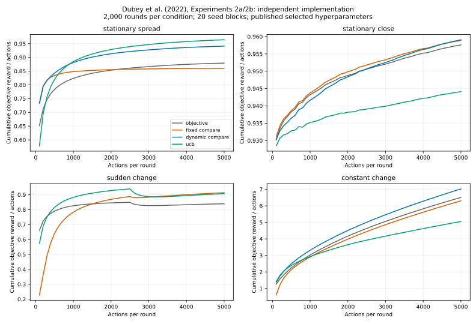
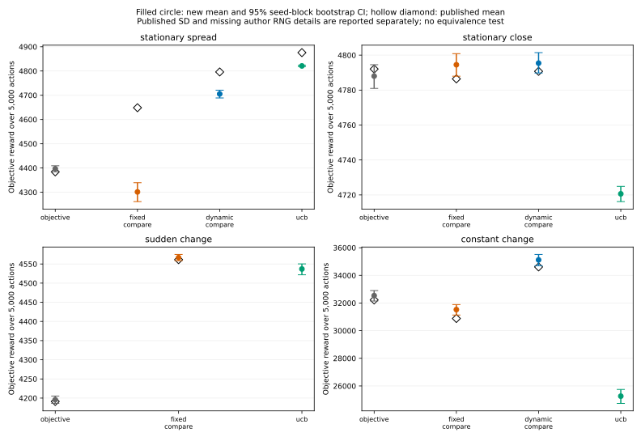

# Dubey, Griffiths and Dayan (2022): comparison and aspiration in bandits

Search and execution date: **2026-10-25 UTC**. Primary source: [The pursuit of
happiness: A reinforcement learning perspective on habituation and comparisons](https://doi.org/10.1371/journal.pcbi.1010316),
*PLOS Computational Biology* 18(8), e1010316, a peer-reviewed computational paper.
This study independently implements its **Experiments 2a and 2b / Figure 5**.
It is not a reproduction of human participants, the paper's gridworld experiments,
or Regesh's frozen hybrid controller.

## Scope and source verification

The [author-hosted full paper](https://cocosci.princeton.edu/papers/dubey2022pursuit.pdf)
was downloaded and read. Its SHA-256 is
`f4068b6979811004dd27f26d5092dce618e6ec6b1e50d81224842857f294e6b3`.
Paper pages 18–21 specify the bandit distributions, selected parameters,
aspiration schedules, and numerical means and standard deviations. Page 26
specifies equations 11–13 and **2,000 rounds of 5,000 actions** per condition.
Published values in the output are transcribed from prose, not estimated from
figure pixels.

The paper links [rach0012/happiness_RL](https://github.com/rach0012/happiness_RL).
We inspected commit `c0af9d85ad2b3724c939c8ea9ef197b3ce7d3123`. Its released
`quick_run.py`, `simple_rl` agents and environment implement gridworld work; a
bandit runner or exact bandit random seeds were not located. The inspected
gridworld agent defaults to initial Q values of zero and random tie breaking.
Those choices are retained here but their bandit identity is unverified. No
author code is copied into this repository or executed. The article is available
under the publisher's CC BY terms; public visibility of the author's code alone
is not treated as a license grant for source redistribution.

**Fidelity label: independent implementation of named published experiments.**
We retain the published bandit environments, learning rules, trial count, horizon,
selected hyperparameters, and outcome definitions. We use fresh PCG64 random
streams and explicit coupled randomization, and omit one underspecified dynamic
schedule. This is not a bitwise rerun of the original code or a reproduction of
the original hyperparameter search.

## Fixed protocol

[Configuration](../../configs/reproductions/happiness.json) was written before
the main run; its protocol timestamp is 20:29:50 UTC. No parameter was selected
from the new simulation outcomes. The published selected parameters are used
directly, rather than repeating the paper's grid searches. Every setting contains
20 independent seed blocks of 100 fresh rounds. Each condition uses 5,000 actions
per round and has the same information about observed rewards. The number of
arms is ten; observation noise has standard deviation one.

| Setting | Environment | Objective learner | Fixed comparison | Dynamic comparison |
|---|---|---|---|---|
| Stationary spread | One mean 1; nine means uniform on [−1, 0.9] | ε=.1; sample mean | ε=0; ρ=3.5; sample mean | ε=0; ρ=2, 2.5, 2.75, 3 in successive 50-action intervals, then 3.5 |
| Stationary close | One mean 1; nine means uniform on [.87, .97] | ε=.1; sample mean | ε=.1; ρ=3.5; sample mean | ε=.1; ρ=2.5 for 50 actions, then 3.5 |
| Sudden change | Spread means, randomly permuted at action 2,500 | ε=.1; α=.1 | ε=0; α=.1; ρ=3.5 | Omitted: exact selected schedule absent |
| Constant change | Ten initial means N(0,1); independent N(0,.1²) mean increments | ε=.1; α=.8 | ε=.1; α=.1; ρ=5 | ε=0; α=.1; ρ starts at 1.5 and rises .005 per action |

Each setting additionally runs the paper's standard UCB index
`Q(a) + sqrt(2 log(t) / N(a))` with sample-average updates, one initial visit per
arm, and random tie breaking. The paper gives no numerical prose UCB mean for
three of the four settings, so those published comparison cells stay absent.

For sample-average learners we execute equation 11:
`Q[a] += ((reward - rho) - Q[a]) / visits[a]`.
For nonstationary learners we execute equation 12:
`Q[a] += alpha * ((reward - rho) - Q[a])`.
Only the selected arm changes. Unselected arm estimates are retained. All agents
start with zero Q values; UCB's unvisited-arm indices are infinite. We use a
uniformly random maximizer for ties rather than adding numerical noise that
could reorder unequal values.

The environment and policy RNGs are independent SeedSequence-derived PCG64
streams. Within a round, controllers share each action time's standard Gaussian
reward innovation and the uniform policy draws. They can choose different arms,
but each controller retains exactly the specified marginal reward distribution.
This coupling improves paired comparisons and does not disclose counterfactual
rewards to a learner. Different settings have separate streams. Sudden change
allows a permutation that happens to leave the optimal arm unchanged, consistent
with an unconditioned random shuffle. Initial constant-change means are observed
for the first action, with random-walk increments before each later action.

There is a discrepancy inside the paper: its Methods describes a .5 aspiration
search grid, while its explicit stationary-spread Results schedule includes
2.75. We implement the explicit reported schedule and do not silently correct it.

## Ordinary-controller causal check

We also execute a fixed-aspiration comparison with an ordinary objective-reward
learner initialized optimistically at `Q=rho`, using the same epsilon, alpha and
random draws. This is an additional control, not an original paper condition.
For constant rho, define `Q_ordinary = Q_comparison + rho`. Both rules then
produce the same update and argmax. Therefore fixed comparison is mathematically
equivalent to ordinary optimistic initialization in these bandits. Numerical
action disagreements are counted over the full run, rather than assuming that
algebra alone guarantees identical floating-point trajectories.

This matters for Regesh: a performance advantage of a reward-offset condition
does not distinguish affect from ordinary exploration through optimistic values.
Nor is subtracting a designer-provided aspiration proof that a software agent
feels unhappy. Reported subjective reward is a defined numerical variable.
The paper itself evaluates optimistic initialization in
[Supplement S1, Figure B](https://doi.org/10.1371/journal.pcbi.1010316.s001):
gridworld experiments use a positive initial-Q search from 0.1 to 1. These
supplementary experiments were not rerun here. The bandit fixed-offset
equivalence above is not a claim of a new theorem or a general refutation of
stateful/dynamic comparison. The supplement was checked after the simulation;
its PDF SHA-256 is
`3e9e9271c07bf57d2f5d923b7c52203b3836508dcd8e5aff1870d4d051e9546f`.

The published selected conditions also use different epsilon and, in the
constant-change setting, different alpha. We preserve those differences to
reproduce the reported configurations. Their comparison therefore does not
isolate reward representation while holding exploration and learning rate fixed.
The ordinary-optimism check does match epsilon and alpha exactly.

## Execution and outputs

```bash
python -m regesh.reproductions.happiness \
  --config configs/reproductions/happiness.json \
  --output results/papers/happiness-new
python -m unittest discover -s tests -p test_happiness_reproduction.py -v
```

Output directories must be empty. The runner preserves its exact source,
configuration, source-paper hash, inspected author commit, Python/NumPy versions,
per-round outcomes, 100-action checkpoint curves, summary, and artifact hashes.
No live LLM or GPU is required. The raw reward and regret records are generated
by actual simulator/learner executions, not model-authored outcomes.

The primary endpoint is cumulative **objective** reward at 5,000 actions, in the
same units as the published mean. We separately retain between-round standard
deviation, total subjective reward, expected pseudo-regret against the best
current arm, optimal-action fraction, second-half fraction, last-500-action
fraction, and the coupled optimistic-initialization action disagreement count.
Confidence intervals resample the 20 independent seed-block means 10,000 times;
paired intervals resample differences of corresponding block means. The 5,000
action times are not treated as independent replicate agents. A paper-reported
between-round SD is not mislabeled as a confidence interval.

The output's difference from each published mean and discrepancy in published
SD units are descriptive. Fresh RNG streams, missing author bandit code, unclear
original Q/tie choices and unavailable author raw observations prevent a claim of
numerical equivalence merely from a small difference or overlapping intervals.
The paper's directional predictions are UCB > dynamic > fixed > objective for
stationary spread, fixed > objective after a sudden change, and dynamic >
objective > fixed for constant change. The stationary-close claim is a lack of
useful improvement from comparison; no equivalence margin is supplied by the
paper, so absence of a significant difference will not be labeled proof of
equivalence. These comparisons do not imply that a mean reported by the original
authors is the true population value.

## Measured results

The run completed in **510.34 seconds wall time** on the available CPU, with
**38,000 condition-round records and 190 million action selections**. There were
2,000 rounds per condition, grouped into 20 independent seed blocks. The raw
[summary](../../results/papers/happiness/summary.json),
[round outcomes](../../results/papers/happiness/rounds.jsonl.gz), and
[checkpoint curves](../../results/papers/happiness/checkpoints.jsonl.gz) retain the
full measurements. Confidence intervals below are local 95% seed-block bootstrap
intervals; SD denotes dispersion between individual rounds.


| Setting | Condition | Published mean (SD) | New mean (SD) | New mean 95% CI |
|---|---|---:|---:|---:|
| stationary spread | objective | 4,384.07 (219.66) | 4,396.97 (238.21) | [4,384.41, 4,409.22] |
| stationary spread | fixed compare | 4,648.57 (182.93) | 4,301.38 (1,019.73) | [4,261.45, 4,339.41] |
| stationary spread | dynamic compare | 4,796.07 (326.45) | 4,705.47 (499.19) | [4,688.81, 4,720.90] |
| stationary spread | ucb | 4,875.81 (170.81) | 4,820.97 (85.36) | [4,817.88, 4,824.04] |
| stationary close | objective | 4,792.05 (134.63) | 4,788.00 (135.89) | [4,780.97, 4,794.54] |
| stationary close | fixed compare | 4,786.41 (133.16) | 4,794.50 (133.85) | [4,787.96, 4,800.84] |
| stationary close | dynamic compare | 4,790.73 (132.74) | 4,795.42 (126.38) | [4,789.80, 4,801.45] |
| stationary close | ucb | Not reported in numerical prose | 4,720.62 (83.99) | [4,716.17, 4,724.88] |
| sudden change | objective | 4,191.19 (180.47) | 4,195.78 (190.15) | [4,186.05, 4,205.37] |
| sudden change | fixed compare | 4,561.30 (235.11) | 4,566.60 (234.13) | [4,558.59, 4,574.85] |
| sudden change | ucb | Not reported in numerical prose | 4,536.93 (345.28) | [4,521.72, 4,550.27] |
| constant change | objective | 32,220.31 (9,930.40) | 32,536.11 (10,157.20) | [32,139.26, 32,901.27] |
| constant change | fixed compare | 30,879.62 (9,933.37) | 31,523.21 (10,123.85) | [31,129.27, 31,886.76] |
| constant change | dynamic compare | 34,609.12 (10,717.57) | 35,119.04 (10,931.65) | [34,702.08, 35,511.96] |
| constant change | ucb | Not reported in numerical prose | 25,261.06 (11,935.68) | [24,734.98, 25,745.42] |


The **sudden-change comparison reproduces the reported direction and approximate
magnitude**: the paper's fixed-minus-objective gap is +370.11 reward units; the
new paired gap is **+370.82 [358.07, 384.14]**. Its new means and round-level SDs
are close to the paper's respective values. This is quantitative correspondence,
not an equivalence test against inaccessible original runs.

The **constant-change directional finding also replicates**. Dynamic comparison
exceeds objective reward by **+2,582.93 [2,534.98, 2,630.21]**, versus the paper's
+2,388.81. Fixed comparison falls below objective by **−1,012.90
[−1,054.43, −969.08]**, versus the paper's −1,340.69. New absolute means exceed
the reported means; the underlying random-walk environments have large
between-round variance, so matching an ordering does not establish matching the
original numerical distributions.

The **stationary-spread fixed-comparison claim does not reproduce**. The paper
reports fixed comparison above objective by +264.50. Here it is **below**
objective by **−95.60 [−134.74, −60.00]**. Its between-round SD is also much
larger (1,019.73 versus the reported 182.93). Dynamic comparison still exceeds
objective by +308.50 [286.26, 329.45], and UCB is highest, but the complete
reported ranking and absolute scores are not recovered. In the stationary-close
setting, fixed and dynamic comparison exceed objective by only +6.50 and +7.42
over 5,000 actions. Individual bootstrap intervals barely exclude zero; these
are unadjusted multiple comparisons and do not justify a broad superiority claim
or prove the paper's practical-equivalence interpretation. The missing author
bandit implementation, exact initializations, and RNG details prevent diagnosing
the disagreement. We did not search alternative implementations after seeing
which one would match the published numbers.

The additional ordinary-controller intervention has a decisive result: **zero
action disagreements in 40 million paired decisions**, with exactly equal
per-round objective rewards, between fixed comparison and objective learning with
optimistic initialization in all four environments. Their paired mean difference
and interval are exactly zero. This validates an ordinary computational account
of the fixed-aspiration behavior in this experiment; it does not show that an
affect interpretation is necessary. Designer-supplied dynamic aspiration remains
a useful exploration intervention in the random-walk environment, but these
measurements do not establish learned emotional development or creative LLM
problem solving.





The [independent stdlib audit](../../results/papers/happiness/independent_metric_check.json)
verified all five frozen run artifact hashes, all 38,000 unique condition-round
records, 76 mean/SD/regret calculations, and every paired per-round equality in
the optimism control. Four unit tests check the update equations against hand
calculations, exact schedule boundaries, tie-breaking order, determinism and
ordinary-control equivalence. Plotting and arithmetic auditing make no model
calls and do not alter the frozen summary.
A [full-horizon deterministic recheck](../../results/papers/happiness/deterministic_recheck.json)
also reran the first sudden-change seed block from scratch with the frozen
source: all 400 condition-round records and 200 checkpoint records matched
exactly, including floating-point outputs and the action-2,500 permutation.
